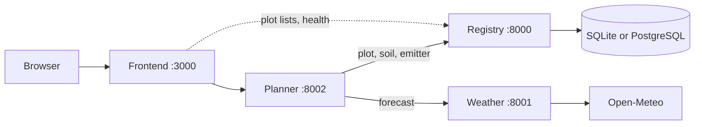

# AgroPilot

AgroPilot helps a grower manage agricultural crops with modern AI.

Today it answers one question: **how many minutes should the drip irrigation run on each plot, for each of the next seven days?** It combines the plot's details, a weather forecast and the FAO-56 irrigation method, and shows the answer on a phone-friendly website.

## How the pieces fit

Four services, each with one job:

| Service | Folder | Port | What it does |
| --- | --- | --- | --- |
| Registry | `services/registry-service` | 8000 | Stores farms and plots, and read-only catalogues of crops, soils and emitters. SQLite or PostgreSQL. |
| Weather | `services/weather-service` | 8001 | Fetches the forecast from Open-Meteo, keeps it in memory, and says when it is stale. |
| Planner | `services/planner-service` | 8002 | Asks the other two services and computes the irrigation plan. |
| Frontend | `services/frontend` | 3000 | The website the grower sees. It only reads. |



One plan request, step by step:

1. The browser opens a plot page on the frontend.
2. The frontend asks the planner for the plan of that plot.
3. The planner asks the registry for the plot, then asks for the soil, the emitter and the forecast at the same time. The first failure cancels the rest, and no plan is made.
4. The planner's engine turns these into daily water needs, litres and run minutes.
5. The answer comes back as JSON, and the frontend shows it, with any warnings, a stale-forecast badge or a clear error.

If any service is down, the site says which one. It never shows zeros in place of missing data.

## Run everything

Requires [uv](https://docs.astral.sh/uv/), Node.js and the `sqlite3` command. Docker is needed only for the PostgreSQL option.

### First time only

```bash
(cd services/registry-service && uv sync && bash seed_registry.sh)
(cd services/weather-service  && uv sync && cp .env.example .env)
(cd services/planner-service  && uv sync && cp .env.example .env)
(cd services/frontend         && npm install && cp .env.example .env.local)
```

Run these from the repository root. The registry needs no settings file: it uses the local `registry.db`. Weather and planner refuse to start without their `.env`, on purpose. Real `.env` files are never committed.

### Every time: four terminals

```bash
# 1 - registry
cd services/registry-service && uv run uvicorn main:app --host 127.0.0.1 --port 8000

# 2 - weather (one worker only: its cache and limits live in memory)
cd services/weather-service && uv run uvicorn main:app --host 127.0.0.1 --port 8001 --workers 1

# 3 - planner
cd services/planner-service && uv run uvicorn main:app --host 127.0.0.1 --port 8002

# 4 - frontend
cd services/frontend && npm run dev
```

Open http://localhost:3000. Stop a service with Ctrl+C in its terminal.

### Check that it works

```bash
curl -s http://127.0.0.1:8000/health
curl -s http://127.0.0.1:8001/health
curl -s http://127.0.0.1:8002/health
curl -s "http://127.0.0.1:8002/v1/plots/c8f3d1b0-4d2e-5a1b-8b22-1d6e3f702002/plan?days=3"
```

The first three return `{"status":"ok"}`. The last one goes through all three services and returns a three-day plan for the sample North block. The weather service calls the real Open-Meteo, so it needs internet.

## Settings

Each service reads its settings from environment variables and a `.env` file in its own folder. A real environment variable wins over the file, and the file wins over the default. See each service's `.env.example` for the names and the README of each service for the meaning.

To run the registry on PostgreSQL instead of SQLite, set `DATABASE_URL` for that run only. The details, including seeding a PostgreSQL database, are in `services/registry-service/README.md`.

## Tests

```bash
(cd services/registry-service && uv run pytest -q)
(cd services/weather-service  && uv run pytest -q)
(cd services/planner-service  && uv run pytest -q)
(cd services/frontend         && npm test)
```

Run these from the repository root.

By default the registry tests use SQLite. The PostgreSQL tests run when `TEST_DATABASE_URL` is set, and they run in CI on every pull request (`.github/workflows/registry-service.yaml`). No test calls the real weather provider.

## More detail

- Each service has its own `README.md` with its rules, settings and numbers.
- Each service has `docs/judgment-log.md`: every decision, what was chosen, why, and what it costs.
- The planner's numbers are explained in `services/planner-service/.claude/skills/irrigation-calc-reference/SKILL.md`.

Weather data by [Open-Meteo.com](https://open-meteo.com/).
