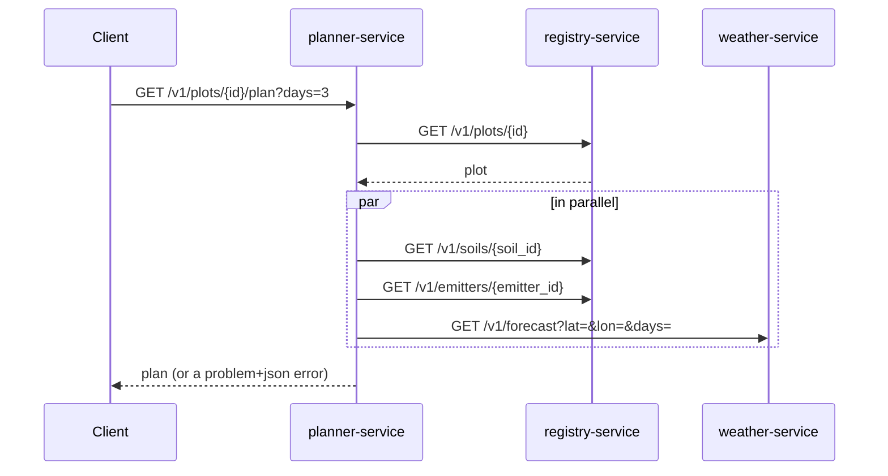

# planner-service

Irrigation plan for one plot, for 1 to 7 days.

`GET /v1/plots/{id}/plan?days=` takes the plot from registry-service and the forecast from weather-service. It runs a pure FAO-56 engine and returns the litres and the minutes of drip to run each day. If an upstream fails, the answer is an error. It is never a plan of zeros.

The service keeps no state. It asks registry and weather on every request.

Weather data by [Open-Meteo.com](https://open-meteo.com/). `forecast.source` is `open-meteo`, so a frontend must show this credit, with the link, next to the plan.

## Run

```
cp .env.example .env
uv run uvicorn main:app --host 127.0.0.1 --port 8002
```

The `.env` file is found next to `config.py`, not in the working directory. A real environment variable wins over `.env`, even an empty one. An empty value is invalid.

A missing or invalid variable stops startup. The error names the variable and the rule, for example `REGISTRY_BASE_URL: required`. It never shows a value.

The port is not a setting. The service keeps no state, so more than one worker is fine.

At startup the service sets the `httpx`, `httpcore` and `uvicorn.access` loggers to WARNING, because the access line of uvicorn holds the request path, so the plot id.

## Settings

| Variable | Default | Rule |
|---|---|---|
| `REGISTRY_BASE_URL` | none, required | `http://` or `https://` URL with a host, no user info, query or fragment. A trailing `/` is removed |
| `WEATHER_BASE_URL` | none, required | same rule |
| `REGISTRY_TIMEOUT_SECONDS` | 2 | number above 0 and at most 30 |
| `REGISTRY_RETRIES` | 1 | whole number 0 to 5 |
| `WEATHER_TIMEOUT_SECONDS` | 12 | number above 0 and at most 240 |
| `WEATHER_RETRIES` | 0 | whole number 0 to 5 |
| `RETRY_DELAY_SECONDS` | 0.3 | number 0 to 10 |

Both base URLs have no default on purpose. A missing `.env` must stop the service, not make it call a guessed address.

Each attempt has a hard deadline. Registry is retried on a timeout, a transport error and a 5xx. It is not retried on a 404 or another 4xx. Weather is retried on every failure, up to `WEATHER_RETRIES`.

An invalid answer from an upstream is a failure of that service. It is not retried.

If you raise weather-service's own timeout or retries, raise `WEATHER_TIMEOUT_SECONDS` above weather's worst case (10 s with its defaults).

### Worst-case wait

```
A = (REGISTRY_RETRIES + 1) x REGISTRY_TIMEOUT_SECONDS + REGISTRY_RETRIES x RETRY_DELAY_SECONDS
B = (WEATHER_RETRIES + 1) x WEATHER_TIMEOUT_SECONDS + WEATHER_RETRIES x RETRY_DELAY_SECONDS
worst case = A + max(A, B)
```

The plot call comes first. The soil, emitter and forecast calls run in parallel.

With the defaults, `A = 4.3 s` and `B = 12 s`, so the worst case is **16.3 s**. With the largest allowed values, `A = 230 s` and `B = 1490 s`, so the worst case is **1720 s**.

## How a request runs

Every plan makes 4 upstream calls: the plot, the soil, the emitter and the forecast. The first failure wins, and the other calls are cancelled.



`days` is optional. Absent means 7. It must appear once and be one digit from 1 to 7. A bad `days` is a 422 before any upstream call.

A stale forecast still gives a plan, and every day has `"stale": true`. A short forecast gives a shorter plan with a `forecast_short` warning. The plan is never padded.

## The plan

### Plan example

The North block on 2026-11-17, three days. It is 261 days after planting, so every day is `after_cycle`.

```json
{
  "plot_id": "c8f3d1b0-4d2e-5a1b-8b22-1d6e3f702002",
  "crop_id": "tomato",
  "area_m2": 1000,
  "flow_lph": 1666.67,
  "taw_mm": 122.5,
  "assumed_start": {"rule": "at_trigger", "bucket_mm": 60.76},
  "forecast": {"source": "open-meteo", "fetched_at": "2026-11-17T06:12:40Z"},
  "warnings": [
    {"code": "planting_date_past_cycle", "days_past_cycle": 116}
  ],
  "days": [
    {"date": "2026-11-17", "stage": "after_cycle", "stale": false,
     "et0_mm": 3.0, "kc": 0.8, "etc_mm": 2.4,
     "rain_mm": 0.0, "rain_counted_mm": 0.0,
     "irrigation_mm": 2.4, "litres": 2400, "run_minutes": 86, "capped": false,
     "bucket_mm": 60.76, "trigger_mm": 60.76},
    {"date": "2026-11-18", "stage": "after_cycle", "stale": false,
     "et0_mm": 2.8, "kc": 0.8, "etc_mm": 2.24,
     "rain_mm": 12.0, "rain_counted_mm": 12.0,
     "irrigation_mm": 0.0, "litres": 0, "run_minutes": 0, "capped": false,
     "bucket_mm": 70.52, "trigger_mm": 59.98},
    {"date": "2026-11-19", "stage": "after_cycle", "stale": false,
     "et0_mm": 3.4, "kc": 0.8, "etc_mm": 2.72,
     "rain_mm": 0.3, "rain_counted_mm": 0.0,
     "irrigation_mm": 0.0, "litres": 0, "run_minutes": 0, "capped": false,
     "bucket_mm": 67.8, "trigger_mm": 62.33}
  ]
}
```

A test checks that this block equals the real output of the service.

### Top-level fields

| Field | Type, unit | Meaning |
|---|---|---|
| `plot_id` | text | the plot asked for |
| `crop_id` | text | the plot's crop (`tomato` or `bell-pepper`) |
| `area_m2` | number, m² | the plot's area |
| `flow_lph` | number, L/h | total flow of the emitters: `area_m2 / (row_spacing_m x emitter_spacing_m) x emitter flow_lph` |
| `taw_mm` | number, mm | total available water of the root zone: soil `available_water_mm_per_m` x root depth |
| `assumed_start` | object | the assumption the plan starts from. `rule` is always `"at_trigger"`. `bucket_mm` is the trigger level of day 1 |
| `forecast` | object | `source` is always `"open-meteo"`. `fetched_at` is weather's value, UTC with `Z` |
| `warnings` | list | objects with a stable `code` and whole numbers, never free text. Empty when there is nothing to warn about |
| `days` | list | one object per day, in date order |

### Warnings

| `code` | Numbers | When |
|---|---|---|
| `planting_date_past_cycle` | `days_past_cycle` | the first plan day is after the last day of the crop cycle |
| `planting_date_in_future` | `days_until_planting` | the planting date is after the first plan day |
| `forecast_short` | `days_requested`, `days_received` | weather returned fewer days than asked |

The planting warning comes first, then `forecast_short`.

### Fields of each day

| Field | Type, unit | Meaning |
|---|---|---|
| `date` | `YYYY-MM-DD` | the date, as weather gave it. The first day is today |
| `stage` | text | `initial`, `development`, `mid`, `late` or `after_cycle`. Before the planting date it is `initial` |
| `stale` | bool | `true` when weather's answer was stale. The same for all days of a plan |
| `et0_mm` | number, mm | weather's ET0, unchanged |
| `kc` | number | the crop coefficient of the day |
| `etc_mm` | number, mm | `kc x et0_mm` |
| `rain_mm` | number, mm | weather's rain, unchanged |
| `rain_counted_mm` | number, mm | the rain that enters the bucket: 0 if `rain_mm` is below `0.2 x et0_mm`, otherwise `rain_mm` |
| `irrigation_mm` | number, mm | the net depth to apply |
| `litres` | whole number, L | `irrigation_mm x area_m2` |
| `run_minutes` | whole number, min | minutes of drip for `litres` at `flow_lph`. 0 means no irrigation that day. Never above 1440 |
| `capped` | bool | `true` when the 1440-minute cap cut the day |
| `bucket_mm` | number, mm | the water in the bucket at the end of the day: `taw_mm` minus depletion |
| `trigger_mm` | number, mm | the level where irrigation starts that day: `taw_mm` minus that day's RAW. It changes from day to day |

On a day with irrigation, `bucket_mm` equals `trigger_mm`. This is by design: the plan irrigates only the overshoot, so the bucket ends exactly on the trigger. The exception is a capped day, where the bucket ends below the trigger.

### Rounding

The engine keeps full precision. Rounding happens once, when the JSON is built.

- `kc` has 3 decimals. Every mm value and `flow_lph` has 2 decimals.
- `litres` and `run_minutes` are whole numbers, each from the full-precision value.
- Ties round half up.
- A day with irrigation never shows fewer than 1 minute, so `run_minutes: 0` always means no irrigation.
- `et0_mm`, `rain_mm` and `fetched_at` are weather's values, unchanged.
- `3.0` and `3` are the same JSON number, so compare parsed values, not text.

## Errors

All errors are `application/problem+json` with `type` (`about:blank`), `title`, `status`, `detail` and `code`.

| Case | Status | `code` | `detail` |
|---|---|---|---|
| Bad `days` | 422 | `VALIDATION` | `days: must be one digit from 1 to 7` |
| Unknown plot, or an id that cannot exist | 404 | `NOT_FOUND` | `Plot not found` |
| Unknown route | 404 | `NOT_FOUND` | |
| Method not allowed | 405 | `VALIDATION` | |
| Registry or weather failed | 503 | `UPSTREAM_UNAVAILABLE` | `registry-service unavailable` or `weather-service unavailable`, with `Retry-After` |
| Unexpected error | 500 | `UNAVAILABLE` | `Internal server error`, no `Retry-After` |

`Retry-After` on a 503 is the upstream's value if it is a whole number from 1 to 60. Otherwise it is 5.

The detail is a fixed text. It never holds anything from an upstream answer.

`GET /health` returns `{"status": "ok"}` and never calls registry or weather.

## Why not "half"

The task's rule is "irrigate when the level falls below half". This service uses FAO-56 instead: `p` from Table 22 for each crop, adjusted each day for ETc. The "half" is a general default, and for bell pepper it is well above FAO's 0.30. The reasons are in the judgment log, entry 1.

## Limitations

- No adjustment of Kc for wind or humidity, because weather gives only ET0 and rain. Table values stand for a standard climate.
- Kc initial is the table value for typical wetting, with no adjustment for frequent wetting or for the wetted fraction of drip.
- One row of FAO Table 11 per crop, whatever the planting season.
- The root depth is fixed at the Table 22 minimum (tomato 0.7 m, bell pepper 0.5 m). A young plant has shallower roots, so in the first weeks the bucket is overestimated. In dry weather the daily dose is unchanged. After heavy rain early in the season, the plan can skip irrigation too long. A growing root depth is a possible later improvement (judgment log, entry 6).
- Rain is a forecast. Runoff is 0. The threshold of `0.2 x ET0` is a rule of thumb, so the result jumps at it.
- The start level is an assumption (`assumed_start`). There is no margin for forecast error and no memory of missed irrigations.
- `Ks` is not used. After a capped day the crop can be below the no-stress limit, and the plan shows it (`bucket_mm` below `trigger_mm`).
- Very small irrigations are kept. After a rain, a run of a few minutes is possible (judgment log, entry 10).
- After the end of the crop cycle, Kc is held at Kc end, with a warning.
- A client that disconnects does not stop the upstream calls. The request keeps calling registry and weather until they answer or fail, and it ends within the worst case (16.3 s with the defaults). There is no rate limit, and each plan makes 4 upstream calls (judgment log, entry 15).

## A demo plot with an old planting date

If a plot's planting date is past the end of the cycle, the plan has the `planting_date_past_cycle` warning. To fix a planting date for a demo, use `PATCH /v1/plots/{id}` in registry-service.

## Tests

From `services/planner-service`:

```
uv run pytest -q -p no:cacheprovider
```

The service code imports nothing from the other services. The tests use fake upstreams, so no other service needs to run.
